#+TITLE: 币安 63 亿美元被盗后，链上 bot 如何套利：一个 bot 净赚 1,205 ETH
#+DATE: 2026-11-02
#+AUTHOR: bytenoob
#+DESCRIPTION: 币安 63 亿美元被盗后，链上 bot 如何套利。黑客为赶在 Tether 冻结前出货，在以太坊上用 4.75 亿 USDT 买 ETH，DEX 上的 ETH 一度比 CEX 贵 38%，持续约 63 分钟。这笔价差被谁分走：套利者、Aave 循环者、backrun 机器人、solver 和区块构建者。
#+KEYWORDS: 以太坊, mev, 币安, 黑客, 套利, 区块构建者, chainlink, aave
#+FILETAGS: :以太坊:mev:
#+LASTMOD: 2026-11-02
#+OPTIONS: toc:t num:nil ^:nil

* 发生了什么

2026 年 10 月 29 日，TRM Labs 估计币安在 10 条区块链上的钱包被转走约 63 亿美元（[[https://www.bleepingcomputer.com/news/security/binance-links-63-billion-crypto-theft-to-compromised-devops-laptop/][BleepingComputer]]，初步数据）。本文只看随后 24 小时以太坊上的事。文中时间均为 UTC+8，从 10 月 30 日凌晨算起。

黑客必须抢时间：Tether 随时可能冻结它手里的 USDT。它在以太坊上用 4.75 亿 USDT 买 ETH：部分走 RFQ solver，部分直接在 DEX 买。一个买家就把 DEX 上的 ETH 价格推到比中心化交易所高 17–38%，持续约 63 分钟。同时，DEX 上的 USDT 跌到 0.918 USDC。

- 最大策略：在 DEX 高价卖出 ETH，利润 + tip 10,752 ETH（约 2,435 万美元）。
- 头部链上 bot：[[https://etherscan.io/address/0x45e9b04942176a513b22acc1ced75c34d2fd9215][0x45e9b0…fd9215]]，backrun 黑客的抛售，净赚 1,205 ETH。
- 头部主体：[[https://etherscan.io/address/0x0cdd9cbb825212c6cc5b0b36239e94218ee661d8][0x0cdd9c…e661d8]]，卖出腿 1,683 ETH；完整循环已实现约 343 万美元。
- 错位峰值：04:45 时 +37.99%；错位窗口 04:35–05:38，约 63 分钟。
- 黑客多付：相对 Chainlink 约 7,760 万美元，换得 174,833 ETH。这是可提取价值的上限，不等于已实现的 MEV 总额。

tip 是 searcher 为让交易上链付给出块方的费用；净利润是 searcher 自己留下的部分。

* 时间轴（UTC+8，10 月 30 日）

- 04:24：Binance 14 向 0x5227 转出 16.15 亿 USDT、16.7 万 ETH。
- 04:33 / 04:48：0x9749 对 Permit2、1inch v6 无限授权 USDT。
- 04:34–04:49：0x9749 经 RFQ 卖出 3.25 亿 USDT，换得 122,316 ETH；DEX 溢价从 0 升到 +38%。
- 04:38：0x5227 向 0x8532 转出 195,460 ETH。
- 04:57–05:00：黑客向 Aave 存入 6,000 万 USDT，借出 19,762 WETH。
- 05:04–05:09：0x77edef、0x7aa4 在 DEX 买入，1.5 亿 USDT 换得 52,517 ETH。
- 05:47：Aave 用一笔交易冻结主要资产、把 LTV 设为 0，此时错位已基本消失。
- 05:47：0x9749 向 0xc887 转出 122,310 ETH。
- 09:17–11:32：0x5227 经 Uniswap V3 Router 抛售被盗山寨币（backrun 和夹子集中在这段）。
- 20:26：Aave 解冻；USDC/USDT 的 LTV 至今仍为 0。

* 谁赚到了钱

#+CAPTION: 各策略的利润 + tip，拆分为净利润与 tip
#+ATTR_HTML: :alt 各策略利润加 tip 的条形图，拆为 searcher 净利润与 tip :width 767 :height 312 :loading lazy :decoding async
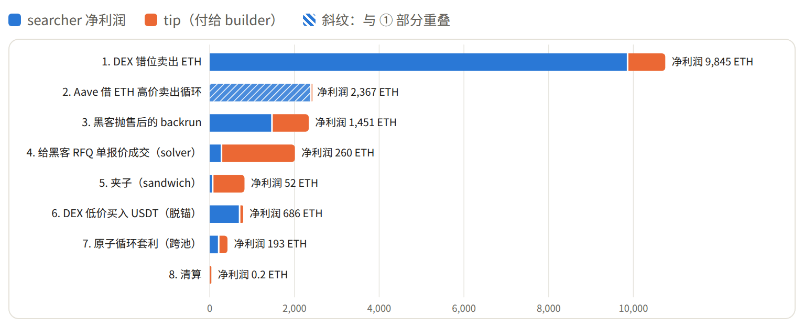

| 策略 | 利润+tip（ETH） | 净利润（ETH） | tip（ETH） | tip 占比 |
|---+---+---+---+---|
| DEX 错位卖出 ETH | 10,752.4 | 9,845.0 | 907.4 | 8% |
| Aave 借 ETH 高价卖出循环 | 2,382.7 | 2,366.6 | 16.1 | 1% |
| 黑客抛售后的 backrun | 2,337.8 | 1,450.8 | 887.1 | 38% |
| 给黑客 RFQ 单报价成交（solver） | 2,011.1 | 259.9 | 1,751.2 | 87% |
| 夹子（sandwich） | 821.1 | 51.9 | 769.2 | 94% |
| DEX 低价买入 USDT（脱锚） | 788.6 | 686.1 | 102.5 | 13% |
| 原子循环套利（跨池） | 420.0 | 192.8 | 227.2 | 54% |
| 清算 | 38.9 | 0.2 | 38.7 | 99% |

在 DEX 高价卖出、在 Aave 循环，赚的是价差；backrun 赚的是黑客抛售后各池子的错位。清算、夹子和 RFQ 的价值，大多以 tip 付给了出块方。

* 八种策略

** 1. 在 DEX 高价卖出 ETH

黑客和 RFQ solver 在 DEX 大额买入 ETH，把主池价格拉到比 CEX 高 17–38%。把 ETH 卖进这些池子，每 1 ETH 赚「DEX 价 − CEX 价」；再在 CEX 做多对冲，或等溢价消失后买回，锁定利润。

#+CAPTION: 利润 = 卖出量 ×（DEX 成交价 − CEX 价）− tip
#+ATTR_HTML: :alt 流程图：黑客和 solver 拉高 DEX 上的 ETH 价格，套利者把 ETH 卖进池子并在 CEX 对冲 :width 755 :height 117 :loading lazy :decoding async
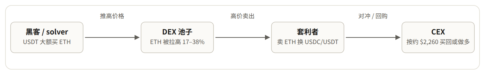

| 子类 | 主体数 | 卖出 ETH | 利润+tip | tip 占比 |
|---+---+---+---+---|
| 自有 ETH 经聚合器卖出 | 1,028 | 84,328 | 5,988.0 | 1% |
| 从 Aave 借来卖出（即策略 Aave 循环的卖出腿） | 36 | 24,374 | 2,678.0 | 0% |
| 专业 bot 合约直接打池子 | 66 | 27,883 | 2,086.5 | 41% |

主体排名前 5：

| 主体 | 类型 | 笔数 | 卖出 ETH | 均价 | 同期 Chainlink | 净利润 | tip | 利润+tip |
|---+---+---+---+---+---+---+---+---|
| [[https://etherscan.io/address/0x0cdd9cbb825212c6cc5b0b36239e94218ee661d8][0x0cdd9c…e661d8]] | Aave 借 11,701 WETH | 18 | 11,682 | 2,595 | 2,268 | 1,676.0 | 7.0 | 1,683.0 |
| [[https://etherscan.io/address/0x51c72848c68a965f66fa7a88855f9f7784502a7f][0x51c728…502a7f]] | bot 合约 | 235 | 22,757 | 2,431 | 2,273 | 866.5 | 746.1 | 1,612.6 |
| [[https://etherscan.io/address/0xcb02ecb8927434540352e1da27f91c3a194f1d1d][0xcb02ec…4f1d1d]] | 自有库存 | 1 | 4,170 | 2,694 | 2,260 | 798.3 | 0.3 | 798.5 |
| [[https://etherscan.io/address/0x65a8f07bd9a8598e1b5b6c0a88f4779dbc077675][0x65a8f0…077675]] | 自有库存 | 37 | 3,704 | 2,531 | 2,271 | 418.3 | 1.5 | 419.8 |
| [[https://etherscan.io/address/0xcaab6ff98989fdd4f47e7db6152e6fb47994ec1e][0xcaab6f…94ec1e]] | Aave 借 1,565 WETH | 6 | 1,560 | 2,710 | 2,273 | 297.9 | 0.0 | 298.0 |

最大的 bot [[https://etherscan.io/address/0x51c72848c68a965f66fa7a88855f9f7784502a7f][0x51c728…502a7f]] 用 69 个发送地址发出 235 笔交易，卖出 22,757 ETH，均价 2,431（同期 Chainlink 为 2,273），利润 + tip 合计 1,612.6 ETH；46% 作为 tip 付给出块方，买区块前排。通过聚合器卖自有 ETH 的大户几乎不付 tip。溢价随卖出迅速衰减，最后一笔仅剩约 4.8%。

** 2. Aave 借 ETH 高价卖出循环

Aave 用 Chainlink 给借款计价，Chainlink 跟随 CEX；DEX 价格却高 17–38%。按 CEX 价借 ETH、按 DEX 价卖出，差价就是利润；稳定币存回作抵押，继续借、继续卖。

#+CAPTION: 溢价 ≥ 1/LTV − 1 = 33.3% 时 r ≥ 1，可零本金用闪电资金启动；按最大 LTV 循环后 HF ≈ 1.04
#+ATTR_HTML: :alt 流程图：按 CEX 价在 Aave 借 ETH，在 DEX 高价卖出，稳定币存回作抵押再借 :width 755 :height 144 :loading lazy :decoding async
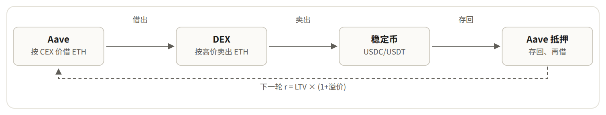

| 主体 | 卖出 ETH @ 均价 | 买回 ETH @ 均价 | 对 CEX markout | 约合 ETH |
|---+---+---+---+---|
| [[https://etherscan.io/address/0x0cdd9cbb825212c6cc5b0b36239e94218ee661d8][0x0cdd9c…e661d8]] | 12,289 @ 2,580 | 12,314 @ 2,298 | $3,433,251 | 1,515.8 |
| [[https://etherscan.io/address/0xcaab6ff98989fdd4f47e7db6152e6fb47994ec1e][0xcaab6f…94ec1e]] | 1,560 @ 2,710 | 624 @ 2,275 | $671,357 | 296.4 |
| [[https://etherscan.io/address/0x9c5b0eb419e52d5d229d01898190a05c357cad08][0x9c5b0e…7cad08]] | 854 @ 2,428 | — | $123,055 | 54.3 |
| [[https://etherscan.io/address/0xc7555293af17aca821e1f0fc3e5d3112a85d3ebe][0xc75552…5d3ebe]] | 1,100 @ 2,343 | — | $66,993 | 29.6 |
| [[https://etherscan.io/address/0x2b41a0850394d716ddd6b0e200c5d43be5bce8fa][0x2b41a0…bce8fa]] | 600 @ 2,355 | 8 @ 2,590 | $41,341 | 18.3 |
| [[https://etherscan.io/address/0xdca6d9de6cba400d497d8fe86fe2832066d9e39a][0xdca6d9…d9e39a]] | 1,450 @ 2,293 | — | $34,623 | 15.3 |
| [[https://etherscan.io/address/0x303d0a175ceec14dd7b3d4f60cabe6cec06a3d9f][0x303d0a…6a3d9f]] | 75 @ 2,467 | — | $13,614 | 6.0 |

头部主体 [[https://etherscan.io/address/0x0cdd9cbb825212c6cc5b0b36239e94218ee661d8][0x0cdd9c…e661d8]] 在 04:50–05:32 连做 18 轮：借出 ETH 经 0x 卖出（$2,390–2,738），USDC 存回。市场冻结后挂 $2,290/$2,300 限价单，由 CoW 和 0x 的 solver 成交，买回 12,313 ETH 还款。卖出均价 $2,580、买回均价 $2,298，ETH 头寸持平，约 2 小时实现约 343 万美元。

05:47，Aave 治理冻结该市场，LTV 设为 0，循环中止。资金不是瓶颈：Aave 利用率仅从 79% 升到 82%。

** 3. 黑客抛售后的 backrun

黑客通过 Uniswap V3 Router 把盗来的山寨币（PHA、ENS 等）一次性砸进单个池子，池价被砸低，同币在其他池子（V2、其他费率）仍是旧价。bot 紧随其后，在同一笔交易里低买高卖；不用抢先，也不担方向风险。

#+CAPTION: 利润 = 池子 B 卖出所得 − 池子 A 买入成本 − tip，一笔交易内闭合
#+ATTR_HTML: :alt 流程图：黑客把币砸进池子 A，bot 紧随其后低价买入，再卖进还是旧价的池子 B :width 755 :height 117 :loading lazy :decoding async
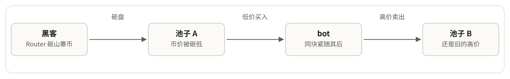

| bot | 笔数 | 利润+tip | tip | tip 占比 |
|---+---+---+---+---|
| [[https://etherscan.io/address/0x45e9b04942176a513b22acc1ced75c34d2fd9215][0x45e9b0…fd9215]] | 29 | 1,452.4 | 247.4 | 17% |
| [[https://etherscan.io/address/0x0000000000d3c71f9d0a31e2f2139da1ca37b599][0x000000…37b599]] | 56 | 493.6 | 369.3 | 75% |
| [[https://etherscan.io/address/0x80bf7db69556d9521c03461978b8fc731dbbd4e4][0x80bf7d…bbd4e4]] | 11 | 79.9 | 52.3 | 65% |
| [[https://etherscan.io/address/0x51c72848c68a965f66fa7a88855f9f7784502a7f][0x51c728…502a7f]] | 9 | 48.7 | 40.6 | 83% |
| [[https://etherscan.io/address/0x36331e299247e5d0d3261e1d9852f6e0cffee95c][0x36331e…fee95c]] | 14 | 44.3 | 37.6 | 85% |

收益最高的 backrun bot [[https://etherscan.io/address/0x45e9b04942176a513b22acc1ced75c34d2fd9215][0x45e9b0…fd9215]] 共 29 笔，利润 + tip 合计 1,452.4 ETH，付 tip 247.4 ETH，净赚 1,205.0 ETH。

单笔最高是 10:32 的 [[https://etherscan.io/tx/0x9988946159d207dbc01efe5c57eb392f423e372d3a072ae36a7377c744fe5269][0x998894…fe5269]]：黑客刚把 PHA 砸进 V3 池，bot [[https://etherscan.io/address/0x45e9b04942176a513b22acc1ced75c34d2fd9215][0x45e9b0…fd9215]] 付 50.08 WETH 买入 317 万 PHA，转入尚未跟跌的 V2 池，换回 301.48 WETH，净得 251.4 WETH，仅付 1.35 ETH tip。294 笔 backrun 中 290 笔盈利。

** 4. 给黑客的 RFQ 订单报价成交

RFQ（询价成交）是大额交易者先向做市商或 solver 询价，签下固定报价订单，由报价方在链上交割。黑客急于在冻结前出货，接受 $2,990/ETH 这类报价，当时 CEX 约 $2,250。solver 在同笔交易里从池子买 ETH 交付，赚报价与成本的差额，但要靠高额贿赂才能抢到订单。

#+CAPTION: 链上交易由 solver 发出（tx.from 和 tx.to 都不是黑客），大部分价差以贿赂付给出块方
#+ATTR_HTML: :alt 流程图：黑客签名 USDT 换 ETH 的订单，solver 在同一笔交易里从 DEX 池子买 ETH 交付 :width 755 :height 117 :loading lazy :decoding async
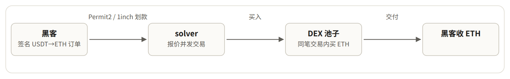

| 交易 | 块 | solver 合约 | 净利润 | tip | 利润+tip | tip 占比 |
|---+---+---+---+---+---+---|
| [[https://etherscan.io/tx/0xa861a556b73df4e084aca07663d63b26eec33136ed7328712a7418361d856f36][0xa861a5…856f36]] | 26300874 | [[https://etherscan.io/address/0xbeef02961503351625926ea9a11ae13b29f5c555][0xbeef02…f5c555]] | 119.0 | 1,070.7 | 1,189.6 | 90% |
| [[https://etherscan.io/tx/0x3fd5ec345eaf60faca94c652f5ac5c0dca77b4ef3c355fb12cb8f5108464a0b6][0x3fd5ec…64a0b6]] | 26300895 | [[https://etherscan.io/address/0x9b1303ebf09bc51b7fac376c9e421e8daae63b82][0x9b1303…e63b82]] | 111.7 | 335.0 | 446.7 | 75% |
| [[https://etherscan.io/tx/0xe5ccc3a8b32f7c52683390fa75f57cec53394421bd05132400806533e661843a][0xe5ccc3…61843a]] | 26300894 | [[https://etherscan.io/address/0xbeef02961503351625926ea9a11ae13b29f5c555][0xbeef02…f5c555]] | 7.2 | 137.1 | 144.3 | 95% |
| [[https://etherscan.io/tx/0x4fa182626c85ca0cdc18ba736930bdbdfbcf5d201d373913317df6ec58d23d61][0x4fa182…d23d61]] | 26300829 | [[https://etherscan.io/address/0x0000000000be226afde21672a5e4adc45692e69d][0x000000…92e69d]] | -0.0 | 93.6 | 93.6 | 100%* |
| [[https://etherscan.io/tx/0xc59188f11b6b7bd18a45b2afc91e787bf66d767dd5b95d01730f3c5c92f1e490][0xc59188…f1e490]] | 26300895 | [[https://etherscan.io/address/0xec4fb7e7c35c241e1138a2d8cfbb09f3ad1ccb22][0xec4fb7…1ccb22]] | -0.0 | 49.1 | 49.1 | 100%* |

最大一笔：[[https://etherscan.io/tx/0xa861a556b73df4e084aca07663d63b26eec33136ed7328712a7418361d856f36][0xa861a5…856f36]] 中，solver [[https://etherscan.io/address/0xbeef02961503351625926ea9a11ae13b29f5c555][0xbeef02…f5c555]] 为黑客 7,500 万 USDT 的订单交付 26,227 ETH，付给出块方 1,070.65 ETH，自己只留 119 WETH，tip 占比约 90%。

给持有被盗资金的地址报价成交，就是与黑客交易，有法律风险。这和针对价格错位的中性套利是两回事。

** 5. 夹子（sandwich）

bot 在受害交易前同方向下单，把价格推向不利于受害者的一侧；受害交易以更差价格成交；bot 再在同一池子反向平仓。这次的受害者主要是黑客抛售山寨币的交易。

#+CAPTION: 夹子有「前腿—受害交易—后腿」三步；backrun 只有「受害交易—后腿」两步
#+ATTR_HTML: :alt 流程图：bot 前腿、受害交易以更差价格成交、bot 后腿、出块方收 tip :width 755 :height 117 :loading lazy :decoding async
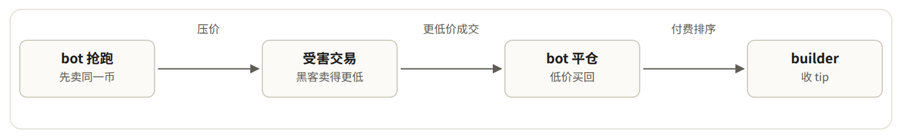

| bot | 对数 | 其中夹黑客 | 净利润 | tip | 利润+tip | 分类 |
|---+---+---+---+---+---+---|
| [[https://etherscan.io/address/0x1f2f10d1c40777ae1da742455c65828ff36df387][0x1f2f10…6df387]] | 105 | 67 | 16.0 | 629.4 | 645.4 | 疑似做市 |
| [[https://etherscan.io/address/0x8f8d0ae3e2d11b3b3f962aab7d19ebe01345cbd9][0x8f8d0a…45cbd9]] | 10 | 7 | 2.0 | 64.5 | 66.5 | 夹子 |
| [[https://etherscan.io/address/0xbadc0de76438f9524d42c219b390636196bfbdfc][0xbadc0d…bfbdfc]] | 14 | 12 | 11.0 | 53.4 | 64.5 | 夹子 |
| [[https://etherscan.io/address/0x6338afee3ff32599bff2ce3d8b7604bd6d6a41a7][0x6338af…6a41a7]] | 15 | 12 | 18.7 | 0.0 | 18.7 | 夹子 |
| [[https://etherscan.io/address/0xe80629c1f9db8d42db953d37990d5f02f449702d][0xe80629…49702d]] | 2 | 0 | 0.0 | 7.5 | 7.6 | 夹子 |
| [[https://etherscan.io/address/0xe59ae6325cfbd44a82f2ff19716019ffed77ebbb][0xe59ae6…77ebbb]] | 1 | 0 | 0.4 | 4.2 | 4.6 | 夹子 |

这 200 对交易利润 + tip 合计 821.1 ETH。做市 bot [[https://etherscan.io/address/0x1f2f10d1c40777ae1da742455c65828ff36df387][0x1f2f10…6df387]] 占 645.4 ETH，净利润仅 16.0 ETH，几乎全作排序费付给出块方，更像为排在黑客交易旁边付费的做市，不是夹子。其余 bot 确认的夹子合计 175.7 ETH。以黑客为受害者的有 105 对。

** 6. 在 DEX 低价买入 USDT（脱锚）

黑客还在 DEX 大量抛售 USDT。Uniswap V3 USDC/USDT 池中，1 USDT 在 04:50 跌至 0.9497 USDC，05:10 跌至 0.9181，CEX 和 Chainlink 上的 USDT 始终在 $0.999 左右。在 DEX 用 USDC 或 DAI 买 USDT，每 1 USDT 赚 5–8 美分。

#+CAPTION: 到 05:47，DEX 上的 USDT 已恢复到约 0.999
#+ATTR_HTML: :alt 流程图：在 DEX 上用 USDC 或 DAI 以约 0.92 买入 USDT，在 CEX 卖出或持有到价格恢复 :width 755 :height 117 :loading lazy :decoding async
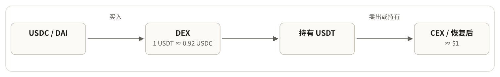

| 交易 | 块 | 买方 | 买入 USDT | 净利润 | tip | 利润+tip |
|---+---+---+---+---+---+---|
| [[https://etherscan.io/tx/0xcc2fb3059f6f1026b88ea43a8d5982a7c8eba9819f85efa0318e6685af04b9d7][0xcc2fb3…04b9d7]] | 26300993 | [[https://etherscan.io/address/0x2b41a0850394d716ddd6b0e200c5d43be5bce8fa][0x2b41a0…bce8fa]] | 2,477,372 | 77.7 | 0.1 | 77.9 |
| [[https://etherscan.io/tx/0xd24be48bc2196f2cdd2650557df167fc94d8f0b6df56468dc78236b51b9a536e][0xd24be4…9a536e]] | 26301072 | [[https://etherscan.io/address/0xcb02ecb8927434540352e1da27f91c3a194f1d1d][0xcb02ec…4f1d1d]] | 11,295,426 | 50.4 | 0.5 | 50.9 |
| [[https://etherscan.io/tx/0x4d401e31c48283ed25ca143c00850482d42c86a74f708c7ea92ad4ceb38202e9][0x4d401e…8202e9]] | 26301008 | [[https://etherscan.io/address/0x9b974128a77a3a1b94f969612999816d8d228e4e][0x9b9741…228e4e]] | 1,475,513 | 45.1 | 0.0 | 45.1 |
| [[https://etherscan.io/tx/0x12bc960af373d3b7c6f3f57a97f58656d65ec9fdf629a11615ffb67dc609f651][0x12bc96…09f651]] | 26300995 | [[https://etherscan.io/address/0x8986f93988d415abfb7b9bb700ccd3580c2f5298][0x8986f9…2f5298]] | 1,088,117 | 38.8 | 0.0 | 38.8 |
| [[https://etherscan.io/tx/0x820501e85c0c52ec09e1682574945aa8635d45437d6676ca9f5282b6b13d874c][0x820501…3d874c]] | 26301066 | [[https://etherscan.io/address/0xaf9b98d2acde5f13eaeaeb0101273cdfa86dcc95][0xaf9b98…6dcc95]] | 6,552,428 | 22.5 | 0.1 | 22.6 |

** 7. 原子循环套利（跨池）

错位期间各池涨幅不一致：V4 与 V3、5bp 与 30bp 池、Curve tricrypto 以及长尾池之间都有价差。bot 在同一笔交易里从便宜池子买入、卖到贵的池子，常借闪电贷，无需本金。

#+CAPTION: 在一笔交易内，于价格不同步的池子之间低买高卖
#+ATTR_HTML: :alt 流程图：可选的闪电贷，在池子 A 低价买入，在池子 B 高价卖出，闭合后净增 :width 755 :height 117 :loading lazy :decoding async
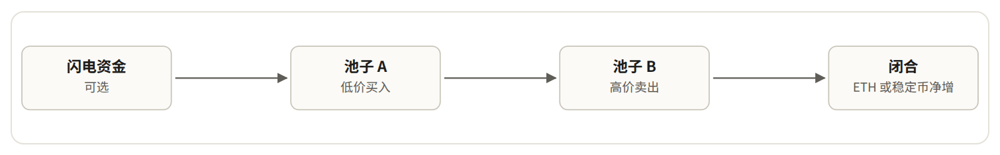

| 交易 | 块 | bot 合约 | 净利润 | tip | 利润+tip | tip 占比 |
|---+---+---+---+---+---+---|
| [[https://etherscan.io/tx/0x585c38d79bf96a7061a6c7a98fa68f38a17ae779f1facfaa3c6c386b2acb1295][0x585c38…cb1295]] | 26301365 | [[https://etherscan.io/address/0x6566194141eefa99af43bb5aa71460ca2dc90245][0x656619…c90245]] | 90.4 | 0.0 | 90.4 | 0% |
| [[https://etherscan.io/tx/0x651fcba40ae60f9970bb56fb55daaa832f76c784c72797bad873525c63aac2b3][0x651fcb…aac2b3]] | 26300830 | [[https://etherscan.io/address/0x0c8c5891a41078cef36970932d5c05dc1de7288b][0x0c8c58…e7288b]] | 10.2 | 62.3 | 72.5 | 86% |
| [[https://etherscan.io/tx/0x4dcc09c3720e291c19cdef5a5d35ba940bba7e05621cf4cfc597a6d55f7b1da3][0x4dcc09…7b1da3]] | 26301013 | [[https://etherscan.io/address/0x584a31052c643d32f3134a956956dad722ff4161][0x584a31…ff4161]] | 4.8 | 65.4 | 70.2 | 93% |
| [[https://etherscan.io/tx/0x287c07eff339f303a32047d6252dc576135e82e08e580256a9d77995b2ce69a7][0x287c07…ce69a7]] | 26301248 | [[https://etherscan.io/address/0xbeef02961503351625926ea9a11ae13b29f5c555][0xbeef02…f5c555]] | 3.1 | 59.2 | 62.3 | 95% |
| [[https://etherscan.io/tx/0x800fc0fde891430589e3f7a43d9345a1ee5da4a01c9fe6684794e5ba3c04f8be][0x800fc0…04f8be]] | 26300829 | [[https://etherscan.io/address/0xea51075ccbd58174834da36372b0ed52199c483c][0xea5107…9c483c]] | 6.1 | 40.1 | 46.3 | 87% |

逐笔复核，这 23 笔交易合计盈利 420.0 ETH。与其他策略比，常规原子套利只是零头。

** 8. 清算

#+CAPTION: HF < 1 时，清算人替借款人还掉部分债务，以折扣价拿走抵押品
#+ATTR_HTML: :alt 流程图：闪电贷，替 HF 小于 1 的仓位还债，折价拿走抵押品，在 DEX 卖出后归还闪电贷 :width 755 :height 117 :loading lazy :decoding async
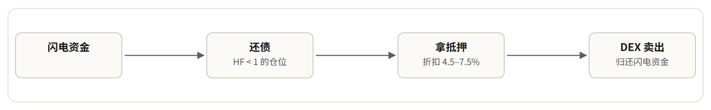

| 协议 | 笔数 | 利润+tip | tip 占比 |
|---+---+---+---|
| aave_core | 38 | 29.81 | 100% |
| morpho_blue | 64 | 5.05 | 96% |
| compound_cUSDCv3 | 3 | 4.04 | 101%* |
| aave_prime | 1 | 0.00 | —（亏损） |
| spark | 1 | 0.00 | —（亏损） |

这段时间几乎无人被清算：错位期间 ETH 的 CEX 价格持续下跌，借 ETH 的仓位反而更健康；公开清算的利润约 99% 付给出块方。值得看的是黑客自己的仓位：11 月 2 日抵押 5,995 万美元 USDT，债务 19,766.28 WETH（初始借款 19,762.41），健康因子 1.0364。

* 区块构建者（builder）

每个块由 builder 打包。搜索者付的优先费和直接贿赂先进入 builder 收款地址，builder 在块末付给验证者，差额即自留。数据覆盖 24 小时全部 7,177 个块。

- 区块总价值：17,008 ETH（约 3,852 万美元）。
- 付给验证者：11,396 ETH，占 67%。
- builder 自留：5,612 ETH，占 33%。
- 04:24–06:50，前 2.5 小时：8,698 ETH，占全天 51%；其中 builder 自留 4,159 ETH。

#+CAPTION: 块总价值 = 优先费 + 搜索者直接转给 builder 的款项
#+ATTR_HTML: :alt 条形图：各 builder 的块价值，拆为付给验证者和 builder 自留 :width 767 :height 335 :loading lazy :decoding async
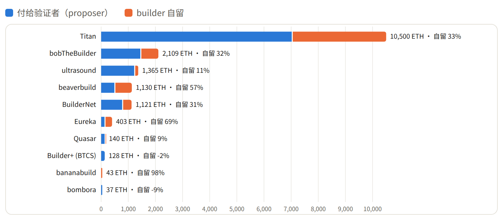

| builder | 收款地址 | 出块数 | 块份额 | 块总价值 | 付给验证者 | builder 自留 | 自留率 | 错位窗口 块数 / 价值 | 最大单块 |
|---+---+---+---+---+---+---+---+---+---|
| Titan | [[https://etherscan.io/address/0x4838b106fce9647bdf1e7877bf73ce8b0bad5f97][0x4838b1…ad5f97]] | 3565 | 49.7% | 10,499.9 | 7,021.9 | 3,478.0 | 33.1% | 415 / 5,950 | 564.7 / 块 26300830 |
| bobTheBuilder | [[https://etherscan.io/address/0xd87f3d6c5624e8b02be13c2c92f8511b88b94d96][0xd87f3d…b94d96]] | 256 | 3.6% | 2,109.3 | 1,444.8 | 664.5 | 31.5% | 15 / 597 | 107.2 / 块 26301434 |
| ultrasound | [[https://etherscan.io/address/0x6c42a0b5d13059fa36d5567ab04f83bab57bbf0e][0x6c42a0…7bbf0e]] | 194 | 2.7% | 1,365.1 | 1,217.8 | 147.3 | 10.8% | 14 / 59 | 179.4 / 块 26302999 |
| beaverbuild | [[https://etherscan.io/address/0x95222290dd7278aa3ddd389cc1e1d165cc4bafe5][0x952222…4bafe5]] | 9 | 0.1% | 1,129.8 | 487.8 | 642.0 | 56.8% | 2 / 1,128 | 1,120.9 / 块 26300874 |
| BuilderNet | [[https://etherscan.io/address/0xdadb0d80178819f2319190d340ce9a924f783711][0xdadb0d…783711]] | 1233 | 17.2% | 1,120.9 | 773.5 | 347.3 | 31.0% | 147 / 539 | 104.9 / 块 26307052 |
| Eureka | [[https://etherscan.io/address/0xfb74767c1ce1aada0a0e114441173b57f8c1571b][0xfb7476…c1571b]] | 128 | 1.8% | 403.1 | 124.6 | 278.5 | 69.1% | 30 / 286 | 72.1 / 块 26300976 |
| Quasar | [[https://etherscan.io/address/0x396343362be2a4da1ce0c1c210945346fb82aa49][0x396343…82aa49]] | 1080 | 15.0% | 140.0 | 127.9 | 12.1 | 8.6% | 67 / 71 | 25.7 / 块 26300999 |
| Builder+ (BTCS) | [[https://etherscan.io/address/0x15566c4f33a9c279f9d3e1a5bb7589fc5a7158b1][0x15566c…7158b1]] / 另 1 个地址 | 89 | 1.2% | 128.3 | 131.2 | -2.9 | -2.2% | 7 / 20 | 14.3 / 块 26302254 |
| bananabuild | [[https://etherscan.io/address/0x8abd0e28f23e0ed4c51eef7494998ca74cb0e9b7][0x8abd0e…b0e9b7]] | 1 | 0.0% | 43.3 | 1.0 | 42.4 | 97.7% | 1 / 43 | 43.3 / 块 26301465 |
| bombora | [[https://etherscan.io/address/0x85c2e985a4fb5c3ff25ee27ee424abd851e4cb33][0x85c2e9…e4cb33]] | 102 | 1.4% | 37.1 | 40.4 | -3.4 | -9.0% | 2 / 1 | 23.0 / 块 26303702 |

#+CAPTION: 被盗后每小时的块总价值（ETH）
#+ATTR_HTML: :alt 条形图：每小时的块总价值，第一个小时达到 5,573 ETH :width 767 :height 216 :loading lazy :decoding async
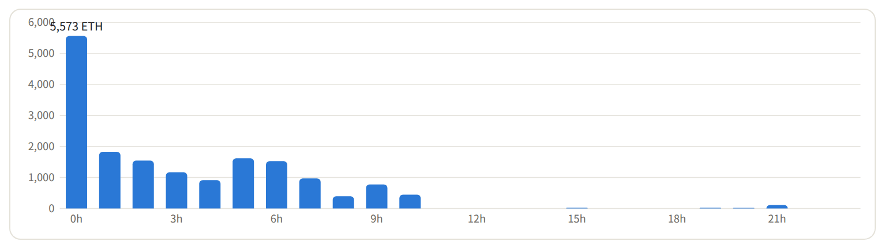

分阶段（表中「错位窗口」为 04:24–06:50）：

| 阶段 | 块范围 | 块数 | 块总价值 | builder 自留 | 自留率 | 出块最多 |
|---+---+---+---+---+---+---|
| 被盗前 | 26300674–26300769 | 96 | 6.5 | 4.0 | 62.3% | Titan（49 块） |
| 错位窗口 | 26300770–26301500 | 731 | 8,697.5 | 4,158.9 | 47.8% | Titan（415 块） |
| 冻结后 | 26301501–26302199 | 699 | 2,380.8 | 644.0 | 27.1% | Titan（436 块） |
| 山寨币抛售 | 26302200–26302900 | 701 | 3,538.0 | 539.3 | 15.2% | Titan（382 块） |
| 其余 | 26302901–26307850 | 4950 | 2,385.2 | 265.8 | 11.1% | Titan（2283 块） |

价值最高的 10 个块：

| 块 | builder | 块总价值 | 付给验证者 | builder 自留 | 验证者收款地址 | 块内最大 tip 交易 |
|---+---+---+---+---+---+---|
| 26300874 | beaverbuild | 1,120.9 | 479.2 | 641.7 | [[https://etherscan.io/address/0x388c818ca8b9251b393131c08a736a67ccb19297][0x388c81…b19297]] | [[https://etherscan.io/tx/0xa861a556b73df4e084aca07663d63b26eec33136ed7328712a7418361d856f36][0xa861a5…856f36]] / tip 1,070.7 ETH |
| 26300830 | Titan | 564.7 | 501.3 | 63.4 | [[https://etherscan.io/address/0xfeeeeee44046c3f61a8cc081e0918ef0de0a7ffc][0xfeeeee…0a7ffc]] | [[https://etherscan.io/tx/0x7fa00a70d10a06e2c46759842c56b3bdd88534a86a0cf63ab2bc5bc8f3e950bf][0x7fa00a…e950bf]] / tip 110.3 ETH |
| 26300875 | Titan | 521.0 | 381.5 | 139.5 | [[https://etherscan.io/address/0xfeeeeee44046c3f61a8cc081e0918ef0de0a7ffc][0xfeeeee…0a7ffc]] | [[https://etherscan.io/tx/0x59e54deda908e602a96062420d366d6fad02a647bb64fd96b765a6a91b947d7b][0x59e54d…947d7b]] / tip 19.3 ETH |
| 26300829 | Titan | 422.6 | 157.3 | 265.2 | [[https://etherscan.io/address/0xfeeeeee44046c3f61a8cc081e0918ef0de0a7ffc][0xfeeeee…0a7ffc]] | [[https://etherscan.io/tx/0x4fa182626c85ca0cdc18ba736930bdbdfbcf5d201d373913317df6ec58d23d61][0x4fa182…d23d61]] / tip 93.6 ETH |
| 26300871 | Titan | 345.5 | 148.4 | 197.1 | [[https://etherscan.io/address/0xfeeeeee44046c3f61a8cc081e0918ef0de0a7ffc][0xfeeeee…0a7ffc]] | [[https://etherscan.io/tx/0x8c40b51efd33505d72ff40757e67ef0483357b1cff9fb6d28e39ddb445487479][0x8c40b5…487479]] / tip 40.2 ETH |
| 26300821 | Titan | 257.6 | 97.5 | 160.1 | [[https://etherscan.io/address/0xfeeeeee44046c3f61a8cc081e0918ef0de0a7ffc][0xfeeeee…0a7ffc]] | [[https://etherscan.io/tx/0x8e0764e9aebe1b71e5b282fcb7d0c4fcae2c0e5d7205961acf4b625da340d41f][0x8e0764…40d41f]] / tip 101.5 ETH |
| 26300894 | Titan | 251.7 | 185.3 | 66.3 | [[https://etherscan.io/address/0xfeeeeee44046c3f61a8cc081e0918ef0de0a7ffc][0xfeeeee…0a7ffc]] | [[https://etherscan.io/tx/0xe5ccc3a8b32f7c52683390fa75f57cec53394421bd05132400806533e661843a][0xe5ccc3…61843a]] / tip 137.1 ETH |
| 26302517 | Titan | 249.8 | 161.4 | 88.4 | [[https://etherscan.io/address/0xfeeeeee44046c3f61a8cc081e0918ef0de0a7ffc][0xfeeeee…0a7ffc]] | [[https://etherscan.io/tx/0x0c4b7a24b48c285cdd5fb3667527946407a503b36a0ad21dcdc794e6c6fe456f][0x0c4b7a…fe456f]] / tip 180.7 ETH |
| 26301013 | Titan | 241.1 | 23.4 | 217.7 | [[https://etherscan.io/address/0xfeeeeee44046c3f61a8cc081e0918ef0de0a7ffc][0xfeeeee…0a7ffc]] | [[https://etherscan.io/tx/0x4c7509b9c9b66c9d0802b12dfe05098e3d346787d09e8254088d775fbd82c832][0x4c7509…82c832]] / tip 101.8 ETH |
| 26300840 | Titan | 180.2 | 28.1 | 152.1 | [[https://etherscan.io/address/0xfeeeeee44046c3f61a8cc081e0918ef0de0a7ffc][0xfeeeee…0a7ffc]] | [[https://etherscan.io/tx/0x88e9f47a7c877a5f06e24beb25d711491d252b4ecb778117adb94dd6e553fa0e][0x88e9f4…53fa0e]] / tip 5.1 ETH |

各策略 tip 流向哪些 builder：

| 策略 | Titan | bobTheBuilder | ultrasound | beaverbuild | BuilderNet | 其他 | 合计 tip |
|---+---+---+---+---+---+---+---|
| RFQ solver | 679.4 / 39% | — | — | 1,070.7 / 61% | 1.2 / 0% | 0.0 | 1,751.2 |
| DEX 错位卖出（首轮） | 850.5 / 94% | 0.1 / 0% | 1.5 / 0% | 0.1 / 0% | 30.2 / 3% | 25.1 | 907.4 |
| backrun | 391.5 / 44% | 331.8 / 37% | 107.1 / 12% | 0.7 / 0% | 36.8 / 4% | 20.0 | 887.8 |
| 夹子 | 760.9 / 99% | 2.0 / 0% | — | — | 5.8 / 1% | 0.5 | 769.2 |
| 原子循环（样本） | 167.9 / 74% | 0.0 / 0% | — | — | 0.1 / 0% | 59.2 | 227.2 |
| USDT 脱锚（首轮） | 89.5 / 87% | — | 0.2 / 0% | — | 11.7 / 11% | 1.7 | 103.0 |
| 清算 | 24.9 / 58% | — | 0.7 / 2% | — | 17.1 / 40% | 0.1 | 42.8 |
| Aave 原子循环 | 15.8 / 99% | — | — | — | 0.0 / 0% | 0.2 | 16.1 |

被盗后 builder 自留比例明显升高：搜索者为抢黑客订单和错位机会付出巨额贿赂（单笔就有 1,070.65 ETH），builder 给验证者的出价没同步跟上。块 26300874（beaverbuild）总价值 1,120.9 ETH，只付给验证者 479.2 ETH，自留 641.7 ETH。另有 154 个块 builder 自留为负（合计 −14.98 ETH）：付给验证者的多于收到的，用来抢出块权。还有 508 个块由验证者本地构建，全部价值直接归验证者。

* 价格：DEX、Chainlink 与 Aave

#+CAPTION: DEX 最高价与 Chainlink ETH/USD 对比，横轴为区块。错位窗口为块 26300824–26301140（04:35–05:38）；Aave 在块 26301183（05:47）冻结。
#+ATTR_HTML: :alt 折线图：DEX 最高价在块 26300874 达到峰值 3,121，而 Chainlink 一直在 2,200 到 2,300 之间 :width 767 :height 327 :loading lazy :decoding async
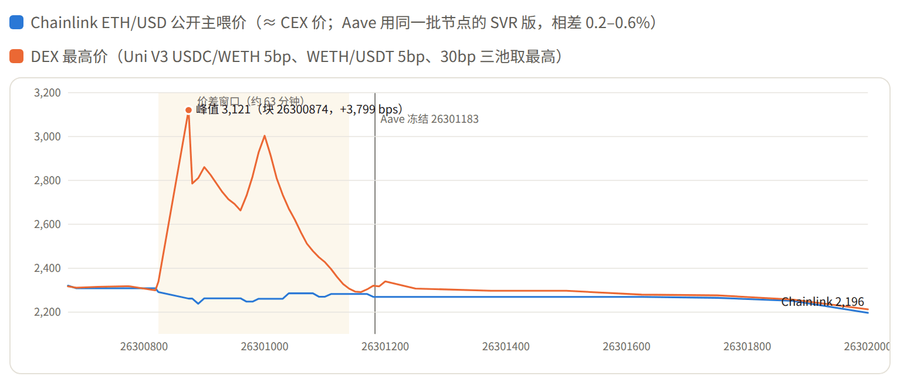

** Aave 用的是 Chainlink，不是 DEX 价

| 块 | Aave 预言机（WETH） | Chainlink 公开主喂价 | CoinGecko（CEX 汇总） | DEX 最高 |
|---+---+---+---+---|
| 26300874 | 2,260.15 | 2,261.50 | 2,259.80 | 3,120.53 |
| 26300900 | 2,249.32 | 2,262.72 | 2,254.55 | 2,860.52 |
| 26300950 | 2,255.51 | 2,262.72 | 2,258.60 | 2,692.64 |
| 26301000 | 2,255.51 | 2,260.40 | 2,260.68 | 3,003.43 |
| 26301060 | 2,282.77 | 2,285.27 | 2,278.30 | 2,563.57 |
| 26301140 | 2,281.38 | 2,281.93 | 2,289.76 | 2,306.66 |

49 个采样点中，Aave 预言机价与 CoinGecko 的 CEX 汇总价最多差 0.51%，DEX 最多高出 38.1%。黑客在 Aave 的借款也能反证：抵押 6,000 万 USDT 借出 19,762.41 WETH，按 Aave 预言机价用掉 99.2% 的额度；按约 2,650 的 DEX 价算，会超出额度 116.5%，根本借不出来。

** 没有一个 Chainlink 节点报出 DEX 价

Chainlink 每次更新都把 31 个节点各自的报价写进链上。错位窗口内，两份 ETH/USD 喂价共更新 25 次，合计 775 个节点报价。其中最高的是 $2,292.87，同一批区块 DEX 最高价 $2,861；节点间最大分歧只有 0.51%。

#+CAPTION: 04:02–07:23 内两份 ETH/USD 喂价的全部 38 次更新；每个点取该次更新 31 个节点报价中的最高值，DEX 为同一区块收盘时的池子价格。
#+ATTR_HTML: :alt 折线图：错位窗口内 DEX 最高价远高于 Chainlink 节点的最高报价 :width 767 :height 299 :loading lazy :decoding async
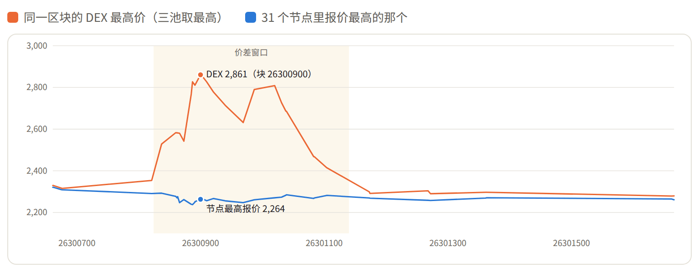

Chainlink 不比 CEX 偏高或偏低，而是贴着 CEX 走：全部 38 次报价都落在 Coinbase 当分钟的高低价之间。喂价偏离 0.5% 时更新，最长 1 小时必更新一次，节点取价到上链约 20 秒（中位数）。所以 Aave 价格最多比市场落后约 0.5%，相对 17–38% 的错位可以忽略。USDT/USD 喂价在错位期间一次都没更新：DEX 上的折价从没影响到全市场价。

** 真正的风险是治理

05:47，一笔交易冻结 Aave 的 11 个资产，把 5 个抵押品的 LTV 设为 0，持续约 14.7 小时（到 20:26）。清算线没变，已有仓位不会因此被清算，但谁也借不了钱：

| 资产 | 冻结前 LTV | 冻结后 LTV | 清算线（未变） |
|---+---+---+---|
| USDT | 75% | 0% | 78% |
| USDC | 75% | 0% | 78% |
| WETH | 81% | 0% | 84% |
| WBTC | 81% | 0% | 85% |
| AAVE | 69% | 0% | 76% |

* 黑客多付了多少

| 卖方 | USDT | 换得 ETH | 均价 | 相对 Chainlink 多付 |
|---+---+---+---+---|
| 0x9749…（9 笔 RFQ 成交） | 325.0M | 122,316 | 2,657 | $45.9M |
| 0x0ddf / 0x77edef / 0x7aa4（5 笔 DEX） | 150.0M | 52,517 | 2,856 | $31.7M |
| 合计 | 475M | 174,833 |  | ≈ $77.6M |

价差流向 RFQ solver、出块方（约 1,751 ETH 贿赂）、把 ETH 卖回 DEX 的套利者，以及 LP 手续费。价格先被拉高，再被套利者压回；一来一回，LP 库存基本不变。

* 黑客资金现状（截至 11 月 2 日）

- 冷钱包：约 430,737 ETH，分存于 4 个从未发出交易的地址，约 9.83 亿美元。
- Tether 冻结：约 13.8 亿 USDT，涉及 3 个被拉黑地址。
- Aave 抵押：6,000 万 USDT，债务 19,766.28 WETH，健康因子 1.0364。

| 地址 | ETH | 来源 |
|---+---+---|
| [[https://etherscan.io/address/0x8532fa14acaf483729c449b8458aeddb900543d4][0x8532fa…0543d4]] | 197,460 | 0x5227 转入（块 26300842 起） |
| [[https://etherscan.io/address/0xc887af690e0301cd4edbbce8f8d31b4ec65b286a][0xc887af…5b286a]] | 137,602 | 0x9749 卖 USDT 所得 + 0x7f9dc988 |
| [[https://etherscan.io/address/0x897c80d1a9729e94460e2bd93178bd5215158df3][0x897c80…158df3]] | 78,415 | 黑客链终点 |
| [[https://etherscan.io/address/0x03b0ee5d82990cff1bda48651ac3e436d1a020ea][0x03b0ee…a020ea]] | 17,260 | 0x5227 转入（块 26303416） |

| 被冻结地址 | USDT |
|---+---|
| [[https://etherscan.io/address/0x5227f603c1ee34ce3c06efe6477003bdfccb2f8c][0x5227f6…cb2f8c]] | 1,175,464,713 |
| [[https://etherscan.io/address/0xaa246bf639586a6ba46762d378ce50ca4fc654a0][0xaa246b…c654a0]] | 174,999,872 |
| [[https://etherscan.io/address/0xb171ca86f82070282138352ff7111b494060c8c3][0xb171ca…60c8c3]] | 30,000,000 |

-----

完整报告（含全部榜单）见[[https://speedex.bytenoob.io/docs/binance-hack-eth-mev-report.html][这里]]。
