#+TITLE: After the $6.3B Binance Hack: How On-Chain Bots Cashed In, One Netted 1,205 ETH
#+DATE: 2026-11-02
#+AUTHOR: bytenoob
#+DESCRIPTION: How on-chain bots cashed in after the $6.3B Binance hack. The attacker swapped 435M USDT for ETH on Ethereum to beat a Tether freeze, and DEX ETH traded up to 38% above CEX prices, with the premium lasting about an hour. Who captured that CEX-DEX spread: arbitrageurs, Aave loopers, backrunners, solvers, and block builders.
#+KEYWORDS: ethereum, mev, binance, hack, arbitrage, block builders, chainlink, aave
#+FILETAGS: :ethereum:mev:
#+LASTMOD: 2026-11-02
#+OPTIONS: toc:t num:nil ^:nil

* What happened

On October 29, 2026, about $6.3 billion moved out of Binance wallets across ten blockchains, by TRM Labs' estimate ([[https://www.bleepingcomputer.com/news/security/binance-links-63-billion-crypto-theft-to-compromised-devops-laptop/][BleepingComputer]], provisional). This post covers only the next 24 hours on Ethereum. All times are UTC+8, starting early on October 30.

The attacker had to move fast: Tether could freeze its USDT at any moment. It bought ETH on Ethereum with 435M USDT: 325M through RFQ solvers and 110M directly on DEXs. That one buyer pushed DEX ETH up to 38% above CEX prices (peak at 04:45). It stayed more than 17% above from 04:45 to 05:16, and the premium lasted about an hour in all (04:35–05:38). Meanwhile, DEX USDT fell to 0.918 USDC.

- *Largest group:* 1,130 addresses sold ETH into the DEX premium. Marked against the CEX price at the time of sale, they made about 9,845 ETH after tips. Most were holders selling their own ETH through aggregators; only 66 were bot contracts.
- *Top on-chain bot:* [[https://etherscan.io/address/0x45e9b04942176a513b22acc1ced75c34d2fd9215][0x45e9b0…fd9215]] backran the hacker's dumps and netted 1,205 ETH.
- *Top address:* [[https://etherscan.io/address/0x0cdd9cbb825212c6cc5b0b36239e94218ee661d8][0x0cdd9c…e661d8]], 1,676 ETH net from its sales; the full borrow-and-sell loop realized about $3.43M.
- *Peak spread:* at 04:45, DEX ETH was 37.99% above CEX; the spread window ran 04:35–05:38, about 63 minutes.
- *Hacker's loss:* it spent 435M USDT on 160,445 ETH, about $70.0M more than that ETH was worth at the Chainlink price. That's the most anyone could have made off the hacker; actual MEV profits were lower.

All earnings here are net profit, after the tip paid to the block builder.

* The hacker's addresses

- *Main wallet* ([[https://etherscan.io/address/0x5227f603c1ee34ce3c06efe6477003bdfccb2f8c][0x5227f6…cb2f8c]]): received the coins from Binance 14 and passed them on to the wallets below; later dumped the altcoins. The 1.175B USDT Tether froze sits here.
- *RFQ wallet* ([[https://etherscan.io/address/0x9749292d74fd460982d0912ea9515ea24736c762][0x974929…36c762]]): received 500M USDT, sold 325M for ETH through RFQ; the remaining 175M went via [[https://etherscan.io/address/0x811f15855476156ebf86ba3b84fafb8ceaa4e84c][0x811f15…a4e84c]] to [[https://etherscan.io/address/0xaa246bf639586a6ba46762d378ce50ca4fc654a0][0xaa246b…c654a0]], where Tether froze it.
- *Aave wallet* ([[https://etherscan.io/address/0x8d53903625b8e839b9df4bd28b0efb1cd6b8639a][0x8d5390…b8639a]]): deposited 60M USDT on Aave and borrowed 19,762 WETH.
- *DEX wallets* ([[https://etherscan.io/address/0x0ddf0480016e6bcb2c1f5d190d221fba1320697e][0x0ddf04…20697e]], [[https://etherscan.io/address/0x77edef23fbd05921c26fe29fcc3a65e14d2ac3eb][0x77edef…2ac3eb]], [[https://etherscan.io/address/0x7aa4d3029e4c6a8e916300014ad95b6d6c03bfd1][0x7aa4d3…03bfd1]]): bought 38,129 ETH on DEXs with 110M USDT.
- *Cold wallets A–D* (table at the end): received ETH and never sent anything out; about 430,737 ETH in total.

* Timeline (UTC+8, October 30)

- 04:24: Binance 14 sends the main wallet 1.615B USDT and 167k ETH.
- 04:30: the main wallet sends 500M USDT to the RFQ wallet.
- 04:33: the main wallet sends 200M USDT to DEX wallet 0x0ddf.
- 04:33 / 04:48: the RFQ wallet gives Permit2 and 1inch v6 unlimited USDT approvals.
- 04:34–04:49: the RFQ wallet sells 325M USDT for 122,316 ETH through RFQ; the DEX premium goes from 0 to +38%.
- 04:38: the main wallet sends 195,460 ETH to cold wallet A.
- 04:47: 0x0ddf buys 3,552 ETH on DEXs with 10M USDT.
- 04:52: 0x0ddf sends 190M USDT to the Aave wallet.
- 04:57–05:00: the Aave wallet deposits 60M USDT on Aave and borrows 19,762 WETH.
- 04:59: the RFQ wallet sends its remaining 175M USDT via [[https://etherscan.io/address/0x811f15855476156ebf86ba3b84fafb8ceaa4e84c][0x811f15…a4e84c]] to [[https://etherscan.io/address/0xaa246bf639586a6ba46762d378ce50ca4fc654a0][0xaa246b…c654a0]], now frozen by Tether.
- 05:01: the Aave wallet sends 130M USDT to 0x77edef; at 05:06, 0x77edef passes 80M to 0x7aa4.
- 05:04–05:09: 0x77edef and 0x7aa4 buy 34,577 ETH on DEXs with 100M USDT.
- 05:11: 0x7aa4 sends its remaining 30M USDT via [[https://etherscan.io/address/0xccbef95633adb5cd2b5038db5a38d77e726ca263][0xccbef9…6ca263]] to [[https://etherscan.io/address/0xb171ca86f82070282138352ff7111b494060c8c3][0xb171ca…60c8c3]], now frozen by Tether.
- 05:47: Aave freezes its main assets and sets LTV to 0 in one transaction; the spread is mostly gone by then.
- 05:47: the RFQ wallet sends 122,310 ETH to cold wallet B.
- 09:17–11:32: the main wallet dumps stolen altcoins through the Uniswap V3 Router (where backruns and sandwiches cluster).
- 20:26: Aave unfreezes; USDC/USDT LTV stays at 0.

* Who made money

#+CAPTION: Net profit by strategy (blue), plus tips paid to builders (orange)
#+ATTR_HTML: :alt Bar chart of net profit by strategy; the orange part is tips paid to builders :width 767 :height 312 :loading lazy :decoding async
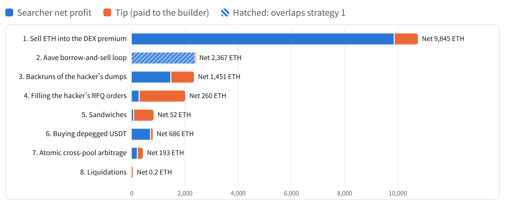

| Strategy | Net profit (ETH) | Tip (ETH) |
|---+---+---|
| Sell ETH into the DEX premium | 9,845.0 | 907.4 |
| Aave borrow-and-sell loop | 2,366.6 | 16.1 |
| Backruns of the hacker's dumps | 1,450.8 | 887.1 |
| Filling the hacker's RFQ orders (solvers) | 259.9 | 1,751.2 |
| Sandwiches | 51.9 | 769.2 |
| Buying depegged USDT on DEXs | 686.1 | 102.5 |
| Atomic cross-pool arbitrage | 192.8 | 227.2 |
| Liquidations | 0.2 | 38.7 |

Selling into the premium and the Aave loop earned the CEX-DEX spread; backruns earned the gaps between pools after the hacker's dumps. Liquidations, sandwiches, and RFQ fills paid most of their value to builders as tips.

* The eight strategies

** 1. Selling ETH into the DEX premium

The hacker and RFQ solvers bought ETH on DEXs in size, pushing the main pools 17–38% above CEX prices. Selling ETH into those pools earned "DEX price − CEX price" per ETH; hedging on a CEX, or buying back once the premium faded, locked it in.

#+CAPTION: Net profit = ETH sold × (DEX price − CEX price) − tip
#+ATTR_HTML: :alt Flow: hacker and solvers push DEX ETH up, arbitrageurs sell ETH into it and hedge on CEXs :width 755 :height 117 :loading lazy :decoding async
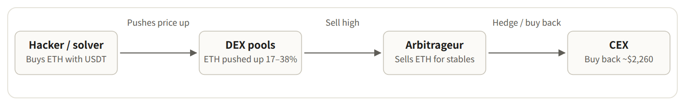

Top five addresses:

| Address | Type | Txs | ETH sold | Avg price | Chainlink at the time | Net profit | tip |
|---+---+---+---+---+---+---+---|
| [[https://etherscan.io/address/0x0cdd9cbb825212c6cc5b0b36239e94218ee661d8][0x0cdd9c…e661d8]] | Aave-borrowed 11,701 WETH | 18 | 11,682 | 2,595 | 2,268 | 1,676.0 | 7.0 |
| [[https://etherscan.io/address/0x51c72848c68a965f66fa7a88855f9f7784502a7f][0x51c728…502a7f]] | bot contract | 235 | 22,757 | 2,431 | 2,273 | 866.5 | 746.1 |
| [[https://etherscan.io/address/0xcb02ecb8927434540352e1da27f91c3a194f1d1d][0xcb02ec…4f1d1d]] | own inventory | 1 | 4,170 | 2,694 | 2,260 | 798.3 | 0.3 |
| [[https://etherscan.io/address/0x65a8f07bd9a8598e1b5b6c0a88f4779dbc077675][0x65a8f0…077675]] | own inventory | 37 | 3,704 | 2,531 | 2,271 | 418.3 | 1.5 |
| [[https://etherscan.io/address/0xcaab6ff98989fdd4f47e7db6152e6fb47994ec1e][0xcaab6f…94ec1e]] | Aave-borrowed 1,565 WETH | 6 | 1,560 | 2,710 | 2,273 | 297.9 | 0.0 |

The biggest bot, [[https://etherscan.io/address/0x51c72848c68a965f66fa7a88855f9f7784502a7f][0x51c728…502a7f]], sent 235 transactions from 69 addresses and sold 22,757 ETH at an average of 2,431 while Chainlink sat at 2,273. It netted 866.5 ETH and paid another 746.1 ETH in tips to buy the front of the block. Large holders selling their own ETH through aggregators paid almost no tip. The premium decayed fast: the last sale captured only about 4.8%.

The 9,845 ETH for this group is a paper gain, marked against the CEX price at the time of sale (as if each seller hedged on a CEX); it isn't realized profit.

** 2. The Aave borrow-and-sell loop

Aave prices loans with Chainlink, which tracks CEXs; DEXs were 17–38% higher. Borrow ETH at the CEX price, sell at the DEX price, deposit the stablecoins as collateral, borrow again.

#+CAPTION: When the premium is ≥ 1/LTV − 1 = 33.3%, r ≥ 1 and the loop can start with zero capital via a flash loan; looping at max LTV ends at HF ≈ 1.04.
#+ATTR_HTML: :alt Flow: borrow ETH on Aave at the CEX price, sell on DEXs at the premium, deposit stablecoins, borrow again :width 755 :height 144 :loading lazy :decoding async
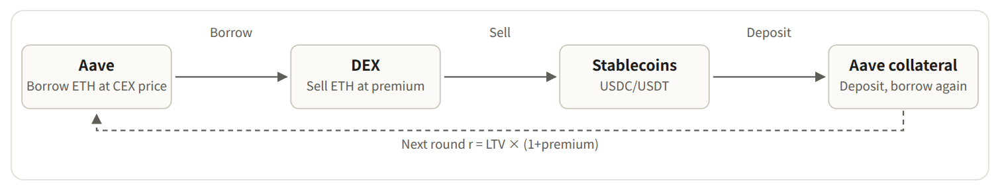

| Address | ETH sold @ avg | ETH bought back @ avg | Markout vs CEX | ≈ ETH |
|---+---+---+---+---|
| [[https://etherscan.io/address/0x0cdd9cbb825212c6cc5b0b36239e94218ee661d8][0x0cdd9c…e661d8]] | 12,289 @ 2,580 | 12,314 @ 2,298 | $3,433,251 | 1,515.8 |
| [[https://etherscan.io/address/0xcaab6ff98989fdd4f47e7db6152e6fb47994ec1e][0xcaab6f…94ec1e]] | 1,560 @ 2,710 | 624 @ 2,275 | $671,357 | 296.4 |
| [[https://etherscan.io/address/0x9c5b0eb419e52d5d229d01898190a05c357cad08][0x9c5b0e…7cad08]] | 854 @ 2,428 | — | $123,055 | 54.3 |
| [[https://etherscan.io/address/0xc7555293af17aca821e1f0fc3e5d3112a85d3ebe][0xc75552…5d3ebe]] | 1,100 @ 2,343 | — | $66,993 | 29.6 |
| [[https://etherscan.io/address/0x2b41a0850394d716ddd6b0e200c5d43be5bce8fa][0x2b41a0…bce8fa]] | 600 @ 2,355 | 8 @ 2,590 | $41,341 | 18.3 |
| [[https://etherscan.io/address/0xdca6d9de6cba400d497d8fe86fe2832066d9e39a][0xdca6d9…d9e39a]] | 1,450 @ 2,293 | — | $34,623 | 15.3 |
| [[https://etherscan.io/address/0x303d0a175ceec14dd7b3d4f60cabe6cec06a3d9f][0x303d0a…6a3d9f]] | 75 @ 2,467 | — | $13,614 | 6.0 |

The top looper, [[https://etherscan.io/address/0x0cdd9cbb825212c6cc5b0b36239e94218ee661d8][0x0cdd9c…e661d8]], ran 18 rounds between 04:50 and 05:32: borrow ETH, sell through 0x ($2,390–2,738), deposit USDC. After the freeze it bought back 12,313 ETH with $2,290/$2,300 limit orders filled by CoW and 0x solvers, then repaid. Average sell $2,580, buy-back $2,298, flat on ETH: about $3.43M realized in roughly two hours.

At 05:47 Aave governance froze the market and set LTV to 0, ending the loop. Funding was never the bottleneck: Aave utilization only rose from 79% to 82%.

** 3. Backruns of the hacker's dumps

The hacker dumped stolen altcoins (PHA, ENS, and others) through the Uniswap V3 Router into one pool at a time. That pool's price dropped; the same token in other pools (V2, other fee tiers) stayed at the old price. A bot landing right after bought low and sold high in one transaction: no front-running, no directional risk.

From 09:17 to 11:32 the hacker dumped more than 30 tokens from the main wallet. The most frequent were OGN (99 sells), RED, CVX, IMX, AXS, CRV and CFG, plus PHA, ENS, YFI, APE and others. Backrun bots traded these altcoins: each transaction buys and sells the same token and closes back into WETH, so profits are in ETH. The five most profitable backruns traded PHA, CFG/RED, ENS (twice) and YFI.

#+CAPTION: Net profit = pool B proceeds − pool A cost − tip, closed in one transaction
#+ATTR_HTML: :alt Flow: hacker dumps into pool A, a bot buys there right after and sells into pool B at the old price :width 755 :height 117 :loading lazy :decoding async
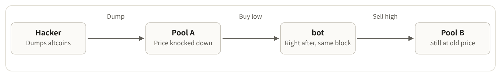

| bot | Txs | Net profit | tip |
|---+---+---+---|
| [[https://etherscan.io/address/0x45e9b04942176a513b22acc1ced75c34d2fd9215][0x45e9b0…fd9215]] | 29 | 1,205.0 | 247.4 |
| [[https://etherscan.io/address/0x0000000000d3c71f9d0a31e2f2139da1ca37b599][0x000000…37b599]] | 56 | 124.3 | 369.3 |
| [[https://etherscan.io/address/0x80bf7db69556d9521c03461978b8fc731dbbd4e4][0x80bf7d…bbd4e4]] | 11 | 27.6 | 52.3 |
| [[https://etherscan.io/address/0x51c72848c68a965f66fa7a88855f9f7784502a7f][0x51c728…502a7f]] | 9 | 8.1 | 40.6 |
| [[https://etherscan.io/address/0x36331e299247e5d0d3261e1d9852f6e0cffee95c][0x36331e…fee95c]] | 14 | 6.7 | 37.6 |

The top backrun bot, [[https://etherscan.io/address/0x45e9b04942176a513b22acc1ced75c34d2fd9215][0x45e9b0…fd9215]], netted 1,205.0 ETH over 29 transactions and paid another 247.4 ETH in tips.

The best single trade was [[https://etherscan.io/tx/0x9988946159d207dbc01efe5c57eb392f423e372d3a072ae36a7377c744fe5269][0x998894…fe5269]] at 10:32: the hacker had just dumped PHA into a V3 pool. Bot [[https://etherscan.io/address/0x45e9b04942176a513b22acc1ced75c34d2fd9215][0x45e9b0…fd9215]] paid 50.08 WETH for 3.17M PHA and sent it into a V2 pool that hadn't followed, receiving 301.48 WETH: a net 251.4 WETH for a 1.35 ETH tip. Of 294 backruns, 290 were profitable.

** 4. Filling the hacker's RFQ orders

With RFQ, a large trader asks market makers or solvers for a quote, signs a fixed-price order, and the quoter settles it on-chain. Racing the freeze, the hacker accepted quotes like $2,990 per ETH while CEXs were around $2,250. Solvers bought the ETH from pools in the same transaction and kept the spread, but had to pay large bribes to win the order.

#+CAPTION: The solver sends the transaction (neither tx.from nor tx.to is the hacker); most of the spread goes to the builder as a bribe.
#+ATTR_HTML: :alt Flow: the hacker signs a USDT to ETH order, a solver buys ETH from DEX pools in the same transaction and delivers it :width 755 :height 117 :loading lazy :decoding async
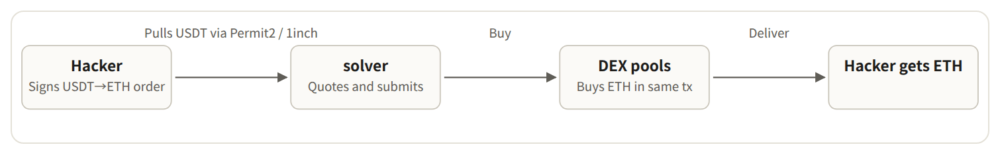

| Tx | Block | Solver contract | Net profit | tip |
|---+---+---+---+---|
| [[https://etherscan.io/tx/0xa861a556b73df4e084aca07663d63b26eec33136ed7328712a7418361d856f36][0xa861a5…856f36]] | 26300874 | [[https://etherscan.io/address/0xbeef02961503351625926ea9a11ae13b29f5c555][0xbeef02…f5c555]] | 119.0 | 1,070.7 |
| [[https://etherscan.io/tx/0x3fd5ec345eaf60faca94c652f5ac5c0dca77b4ef3c355fb12cb8f5108464a0b6][0x3fd5ec…64a0b6]] | 26300895 | [[https://etherscan.io/address/0x9b1303ebf09bc51b7fac376c9e421e8daae63b82][0x9b1303…e63b82]] | 111.7 | 335.0 |
| [[https://etherscan.io/tx/0xe5ccc3a8b32f7c52683390fa75f57cec53394421bd05132400806533e661843a][0xe5ccc3…61843a]] | 26300894 | [[https://etherscan.io/address/0xbeef02961503351625926ea9a11ae13b29f5c555][0xbeef02…f5c555]] | 7.2 | 137.1 |
| [[https://etherscan.io/tx/0x4fa182626c85ca0cdc18ba736930bdbdfbcf5d201d373913317df6ec58d23d61][0x4fa182…d23d61]] | 26300829 | [[https://etherscan.io/address/0x0000000000be226afde21672a5e4adc45692e69d][0x000000…92e69d]] | -0.0 | 93.6 |
| [[https://etherscan.io/tx/0xc59188f11b6b7bd18a45b2afc91e787bf66d767dd5b95d01730f3c5c92f1e490][0xc59188…f1e490]] | 26300895 | [[https://etherscan.io/address/0xec4fb7e7c35c241e1138a2d8cfbb09f3ad1ccb22][0xec4fb7…1ccb22]] | -0.0 | 49.1 |

The largest fill: in [[https://etherscan.io/tx/0xa861a556b73df4e084aca07663d63b26eec33136ed7328712a7418361d856f36][0xa861a5…856f36]], solver [[https://etherscan.io/address/0xbeef02961503351625926ea9a11ae13b29f5c555][0xbeef02…f5c555]] delivered 26,227 ETH for the hacker's 75M USDT order, paid the builder 1,070.65 ETH, and kept 119 WETH: about 90% of the value went to the bribe.

Quoting for addresses holding stolen funds is trading with the attacker, which carries legal risk. That's not the same as neutrally arbitraging a price gap.

** 5. Sandwiches

A bot trades in the victim's direction just before the victim's transaction, the victim fills at a worse price, and the bot closes in the same pool right after. This time the victims were mostly the hacker's altcoin dumps.

The typical case was the hacker's altcoin dumps: the bot sells the same token just before the hacker, pushing the pool price down; the hacker's sell fills lower; the bot buys back cheaper right after and ends in WETH. The two most profitable pairs both hit the hacker: RED at 10:44 (1.9 ETH net, 60.4 ETH in tips) and APE at 11:07 (0.9 ETH net, 43.0 ETH in tips). Not every victim was the hacker: the pairs at 06:35 and 06:41 hit [[https://etherscan.io/address/0x42cdf00c85005630cc8605731b9364f712077810][0x42cdf0…077810]]'s UNI trades.

#+CAPTION: A sandwich has three steps (front leg, victim, back leg); a backrun has two (victim, back leg).
#+ATTR_HTML: :alt Flow: bot front leg, victim transaction at a worse price, bot back leg, builder takes the tip :width 755 :height 117 :loading lazy :decoding async
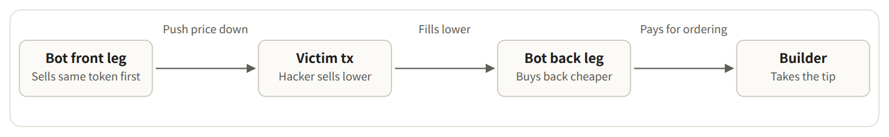

| bot | Pairs | Of which on the hacker | Net profit | tip | Class |
|---+---+---+---+---+---|
| [[https://etherscan.io/address/0x1f2f10d1c40777ae1da742455c65828ff36df387][0x1f2f10…6df387]] | 105 | 67 | 16.0 | 629.4 | likely market maker |
| [[https://etherscan.io/address/0x8f8d0ae3e2d11b3b3f962aab7d19ebe01345cbd9][0x8f8d0a…45cbd9]] | 10 | 7 | 2.0 | 64.5 | sandwich |
| [[https://etherscan.io/address/0xbadc0de76438f9524d42c219b390636196bfbdfc][0xbadc0d…bfbdfc]] | 14 | 12 | 11.0 | 53.4 | sandwich |
| [[https://etherscan.io/address/0x6338afee3ff32599bff2ce3d8b7604bd6d6a41a7][0x6338af…6a41a7]] | 15 | 12 | 18.7 | 0.0 | sandwich |
| [[https://etherscan.io/address/0xe80629c1f9db8d42db953d37990d5f02f449702d][0xe80629…49702d]] | 2 | 0 | 0.0 | 7.5 | sandwich |
| [[https://etherscan.io/address/0xe59ae6325cfbd44a82f2ff19716019ffed77ebbb][0xe59ae6…77ebbb]] | 1 | 0 | 0.4 | 4.2 | sandwich |

These 200 pairs netted 51.9 ETH in total, while paying builders 769.2 ETH in tips. Market-maker bot [[https://etherscan.io/address/0x1f2f10d1c40777ae1da742455c65828ff36df387][0x1f2f10…6df387]] netted 16.0 ETH and paid 629.4 ETH in tips: a market maker paying to sit next to the hacker's trades, not a sandwicher. The other bots' sandwiches netted about 35.9 ETH. 105 pairs had the hacker as the victim.

** 6. Buying depegged USDT

The hacker also dumped USDT on DEXs. In the Uniswap V3 USDC/USDT pool, USDT fell to 0.9497 USDC at 04:50 and 0.9181 at 05:10, while CEXs and Chainlink kept USDT near $0.999. Buying USDT with USDC or DAI earned 5–8 cents per USDT.

#+CAPTION: By 05:47, USDT on DEXs had recovered to about 0.999.
#+ATTR_HTML: :alt Flow: buy USDT with USDC or DAI on DEXs at about 0.92, sell on CEXs or hold until it recovers :width 755 :height 117 :loading lazy :decoding async
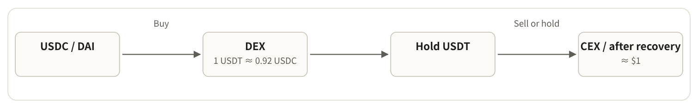

| Tx | Block | Buyer | USDT bought | Net profit | tip |
|---+---+---+---+---+---|
| [[https://etherscan.io/tx/0xcc2fb3059f6f1026b88ea43a8d5982a7c8eba9819f85efa0318e6685af04b9d7][0xcc2fb3…04b9d7]] | 26300993 | [[https://etherscan.io/address/0x2b41a0850394d716ddd6b0e200c5d43be5bce8fa][0x2b41a0…bce8fa]] | 2,477,372 | 77.7 | 0.1 |
| [[https://etherscan.io/tx/0xd24be48bc2196f2cdd2650557df167fc94d8f0b6df56468dc78236b51b9a536e][0xd24be4…9a536e]] | 26301072 | [[https://etherscan.io/address/0xcb02ecb8927434540352e1da27f91c3a194f1d1d][0xcb02ec…4f1d1d]] | 11,295,426 | 50.4 | 0.5 |
| [[https://etherscan.io/tx/0x4d401e31c48283ed25ca143c00850482d42c86a74f708c7ea92ad4ceb38202e9][0x4d401e…8202e9]] | 26301008 | [[https://etherscan.io/address/0x9b974128a77a3a1b94f969612999816d8d228e4e][0x9b9741…228e4e]] | 1,475,513 | 45.1 | 0.0 |
| [[https://etherscan.io/tx/0x12bc960af373d3b7c6f3f57a97f58656d65ec9fdf629a11615ffb67dc609f651][0x12bc96…09f651]] | 26300995 | [[https://etherscan.io/address/0x8986f93988d415abfb7b9bb700ccd3580c2f5298][0x8986f9…2f5298]] | 1,088,117 | 38.8 | 0.0 |
| [[https://etherscan.io/tx/0x820501e85c0c52ec09e1682574945aa8635d45437d6676ca9f5282b6b13d874c][0x820501…3d874c]] | 26301066 | [[https://etherscan.io/address/0xaf9b98d2acde5f13eaeaeb0101273cdfa86dcc95][0xaf9b98…6dcc95]] | 6,552,428 | 22.5 | 0.1 |

** 7. Atomic cross-pool arbitrage

Pools didn't reprice in sync: V4 versus V3, 5 bp versus 30 bp, Curve tricrypto, and long-tail pools all diverged. Bots bought in the cheap pool and sold in the expensive one in a single transaction, often with flash loans and no capital.

#+CAPTION: Buy low and sell high across out-of-sync pools in one transaction
#+ATTR_HTML: :alt Flow: optional flash loan, buy in pool A, sell in pool B, close with a net gain :width 755 :height 117 :loading lazy :decoding async
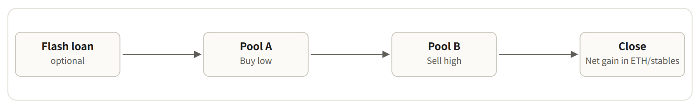

| Tx | Block | bot contract | Net profit | tip |
|---+---+---+---+---|
| [[https://etherscan.io/tx/0x585c38d79bf96a7061a6c7a98fa68f38a17ae779f1facfaa3c6c386b2acb1295][0x585c38…cb1295]] | 26301365 | [[https://etherscan.io/address/0x6566194141eefa99af43bb5aa71460ca2dc90245][0x656619…c90245]] | 90.4 | 0.0 |
| [[https://etherscan.io/tx/0x651fcba40ae60f9970bb56fb55daaa832f76c784c72797bad873525c63aac2b3][0x651fcb…aac2b3]] | 26300830 | [[https://etherscan.io/address/0x0c8c5891a41078cef36970932d5c05dc1de7288b][0x0c8c58…e7288b]] | 10.2 | 62.3 |
| [[https://etherscan.io/tx/0x4dcc09c3720e291c19cdef5a5d35ba940bba7e05621cf4cfc597a6d55f7b1da3][0x4dcc09…7b1da3]] | 26301013 | [[https://etherscan.io/address/0x584a31052c643d32f3134a956956dad722ff4161][0x584a31…ff4161]] | 4.8 | 65.4 |
| [[https://etherscan.io/tx/0x287c07eff339f303a32047d6252dc576135e82e08e580256a9d77995b2ce69a7][0x287c07…ce69a7]] | 26301248 | [[https://etherscan.io/address/0xbeef02961503351625926ea9a11ae13b29f5c555][0xbeef02…f5c555]] | 3.1 | 59.2 |
| [[https://etherscan.io/tx/0x800fc0fde891430589e3f7a43d9345a1ee5da4a01c9fe6684794e5ba3c04f8be][0x800fc0…04f8be]] | 26300829 | [[https://etherscan.io/address/0xea51075ccbd58174834da36372b0ed52199c483c][0xea5107…9c483c]] | 6.1 | 40.1 |

Checked one by one, these 23 transactions netted 192.8 ETH and paid another 227.2 ETH in tips. Next to the other strategies, classic atomic arbitrage was small change.

** 8. Liquidations

#+CAPTION: With HF < 1, a liquidator repays part of the debt and takes collateral at a discount
#+ATTR_HTML: :alt Flow: flash loan, repay a position with HF below 1, seize collateral at a discount, sell on DEXs, repay the loan :width 755 :height 117 :loading lazy :decoding async
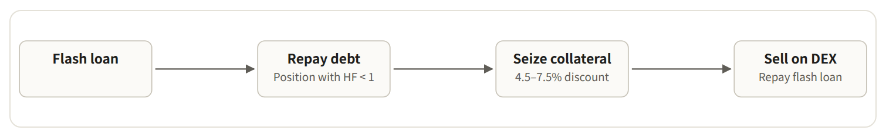

Almost nobody got liquidated. During the spread window the CEX price of ETH was falling, so positions that borrowed ETH became healthier. The 107 public liquidations netted only 0.2 ETH in total; 38.7 ETH went to builders as tips. One position to watch is the hacker's own: on November 2 it held $59.95M USDT of collateral against 19,766.28 WETH of debt (19,762.41 initially borrowed), with a health factor of 1.0364.

* Block builders

Each block is built by a builder. Priority fees and direct bribes go to the builder's fee address; the builder pays the validator at the end of the block and keeps the difference. The data covers all 7,177 blocks in the 24 hours.

- *Total block value:* 17,008 ETH (about $38.52M).
- *Paid to validators:* 11,396 ETH (67%).
- *Kept by builders:* 5,612 ETH (33%).
- *04:24–06:50, the first 2.5 hours:* 8,698 ETH, 51% of the day; builders kept 4,159 ETH of it.

#+CAPTION: Block value = priority fees + direct transfers from searchers to the builder
#+ATTR_HTML: :alt Bar chart of block value per builder, split into the part paid to validators and the part the builder kept :width 767 :height 335 :loading lazy :decoding async
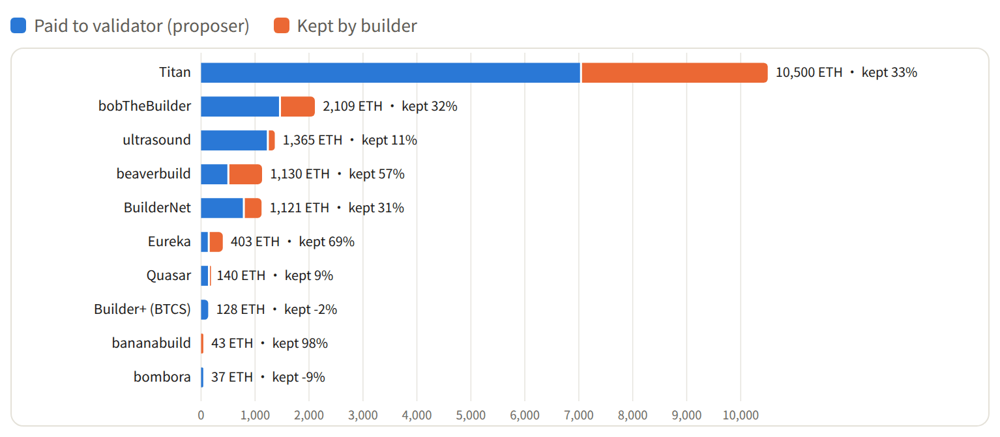

| builder | Fee recipient | Blocks | Block share | Block value | Paid to validator | Kept by builder | Kept % | First 2.5 hours: blocks / value | Largest block |
|---+---+---+---+---+---+---+---+---+---|
| Titan | [[https://etherscan.io/address/0x4838b106fce9647bdf1e7877bf73ce8b0bad5f97][0x4838b1…ad5f97]] | 3565 | 49.7% | 10,499.9 | 7,021.9 | 3,478.0 | 33.1% | 415 / 5,950 | 564.7 / block 26300830 |
| bobTheBuilder | [[https://etherscan.io/address/0xd87f3d6c5624e8b02be13c2c92f8511b88b94d96][0xd87f3d…b94d96]] | 256 | 3.6% | 2,109.3 | 1,444.8 | 664.5 | 31.5% | 15 / 597 | 107.2 / block 26301434 |
| ultrasound | [[https://etherscan.io/address/0x6c42a0b5d13059fa36d5567ab04f83bab57bbf0e][0x6c42a0…7bbf0e]] | 194 | 2.7% | 1,365.1 | 1,217.8 | 147.3 | 10.8% | 14 / 59 | 179.4 / block 26302999 |
| beaverbuild | [[https://etherscan.io/address/0x95222290dd7278aa3ddd389cc1e1d165cc4bafe5][0x952222…4bafe5]] | 9 | 0.1% | 1,129.8 | 487.8 | 642.0 | 56.8% | 2 / 1,128 | 1,120.9 / block 26300874 |
| BuilderNet | [[https://etherscan.io/address/0xdadb0d80178819f2319190d340ce9a924f783711][0xdadb0d…783711]] | 1233 | 17.2% | 1,120.9 | 773.5 | 347.3 | 31.0% | 147 / 539 | 104.9 / block 26307052 |
| Eureka | [[https://etherscan.io/address/0xfb74767c1ce1aada0a0e114441173b57f8c1571b][0xfb7476…c1571b]] | 128 | 1.8% | 403.1 | 124.6 | 278.5 | 69.1% | 30 / 286 | 72.1 / block 26300976 |
| Quasar | [[https://etherscan.io/address/0x396343362be2a4da1ce0c1c210945346fb82aa49][0x396343…82aa49]] | 1080 | 15.0% | 140.0 | 127.9 | 12.1 | 8.6% | 67 / 71 | 25.7 / block 26300999 |
| Builder+ (BTCS) | [[https://etherscan.io/address/0x15566c4f33a9c279f9d3e1a5bb7589fc5a7158b1][0x15566c…7158b1]] / +1 more | 89 | 1.2% | 128.3 | 131.2 | -2.9 | -2.2% | 7 / 20 | 14.3 / block 26302254 |
| bananabuild | [[https://etherscan.io/address/0x8abd0e28f23e0ed4c51eef7494998ca74cb0e9b7][0x8abd0e…b0e9b7]] | 1 | 0.0% | 43.3 | 1.0 | 42.4 | 97.7% | 1 / 43 | 43.3 / block 26301465 |
| bombora | [[https://etherscan.io/address/0x85c2e985a4fb5c3ff25ee27ee424abd851e4cb33][0x85c2e9…e4cb33]] | 102 | 1.4% | 37.1 | 40.4 | -3.4 | -9.0% | 2 / 1 | 23.0 / block 26303702 |

#+CAPTION: Total block value per hour after the hack (ETH)
#+ATTR_HTML: :alt Bar chart of total block value per hour; the first hour reached 5,573 ETH :width 767 :height 216 :loading lazy :decoding async
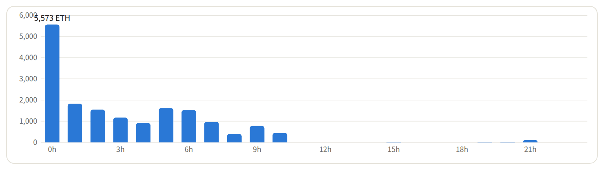

By phase:

| Phase | Block range | Blocks | Block value | Kept by builder | Kept % | Top builder |
|---+---+---+---+---+---+---|
| Before the hack | 26300674–26300769 | 96 | 6.5 | 4.0 | 62.3% | Titan (49 blocks) |
| First 2.5 hours | 26300770–26301500 | 731 | 8,697.5 | 4,158.9 | 47.8% | Titan (415 blocks) |
| After the freeze | 26301501–26302199 | 699 | 2,380.8 | 644.0 | 27.1% | Titan (436 blocks) |
| Altcoin dumping | 26302200–26302900 | 701 | 3,538.0 | 539.3 | 15.2% | Titan (382 blocks) |
| Rest | 26302901–26307850 | 4950 | 2,385.2 | 265.8 | 11.1% | Titan (2283 blocks) |

The ten most valuable blocks:

| Block | builder | Block value | Paid to validator | Kept by builder | Validator fee recipient | Largest-tip tx in block |
|---+---+---+---+---+---+---|
| 26300874 | beaverbuild | 1,120.9 | 479.2 | 641.7 | [[https://etherscan.io/address/0x388c818ca8b9251b393131c08a736a67ccb19297][0x388c81…b19297]] | [[https://etherscan.io/tx/0xa861a556b73df4e084aca07663d63b26eec33136ed7328712a7418361d856f36][0xa861a5…856f36]] / tip 1,070.7 ETH |
| 26300830 | Titan | 564.7 | 501.3 | 63.4 | [[https://etherscan.io/address/0xfeeeeee44046c3f61a8cc081e0918ef0de0a7ffc][0xfeeeee…0a7ffc]] | [[https://etherscan.io/tx/0x7fa00a70d10a06e2c46759842c56b3bdd88534a86a0cf63ab2bc5bc8f3e950bf][0x7fa00a…e950bf]] / tip 110.3 ETH |
| 26300875 | Titan | 521.0 | 381.5 | 139.5 | [[https://etherscan.io/address/0xfeeeeee44046c3f61a8cc081e0918ef0de0a7ffc][0xfeeeee…0a7ffc]] | [[https://etherscan.io/tx/0x59e54deda908e602a96062420d366d6fad02a647bb64fd96b765a6a91b947d7b][0x59e54d…947d7b]] / tip 19.3 ETH |
| 26300829 | Titan | 422.6 | 157.3 | 265.2 | [[https://etherscan.io/address/0xfeeeeee44046c3f61a8cc081e0918ef0de0a7ffc][0xfeeeee…0a7ffc]] | [[https://etherscan.io/tx/0x4fa182626c85ca0cdc18ba736930bdbdfbcf5d201d373913317df6ec58d23d61][0x4fa182…d23d61]] / tip 93.6 ETH |
| 26300871 | Titan | 345.5 | 148.4 | 197.1 | [[https://etherscan.io/address/0xfeeeeee44046c3f61a8cc081e0918ef0de0a7ffc][0xfeeeee…0a7ffc]] | [[https://etherscan.io/tx/0x8c40b51efd33505d72ff40757e67ef0483357b1cff9fb6d28e39ddb445487479][0x8c40b5…487479]] / tip 40.2 ETH |
| 26300821 | Titan | 257.6 | 97.5 | 160.1 | [[https://etherscan.io/address/0xfeeeeee44046c3f61a8cc081e0918ef0de0a7ffc][0xfeeeee…0a7ffc]] | [[https://etherscan.io/tx/0x8e0764e9aebe1b71e5b282fcb7d0c4fcae2c0e5d7205961acf4b625da340d41f][0x8e0764…40d41f]] / tip 101.5 ETH |
| 26300894 | Titan | 251.7 | 185.3 | 66.3 | [[https://etherscan.io/address/0xfeeeeee44046c3f61a8cc081e0918ef0de0a7ffc][0xfeeeee…0a7ffc]] | [[https://etherscan.io/tx/0xe5ccc3a8b32f7c52683390fa75f57cec53394421bd05132400806533e661843a][0xe5ccc3…61843a]] / tip 137.1 ETH |
| 26302517 | Titan | 249.8 | 161.4 | 88.4 | [[https://etherscan.io/address/0xfeeeeee44046c3f61a8cc081e0918ef0de0a7ffc][0xfeeeee…0a7ffc]] | [[https://etherscan.io/tx/0x0c4b7a24b48c285cdd5fb3667527946407a503b36a0ad21dcdc794e6c6fe456f][0x0c4b7a…fe456f]] / tip 180.7 ETH |
| 26301013 | Titan | 241.1 | 23.4 | 217.7 | [[https://etherscan.io/address/0xfeeeeee44046c3f61a8cc081e0918ef0de0a7ffc][0xfeeeee…0a7ffc]] | [[https://etherscan.io/tx/0x4c7509b9c9b66c9d0802b12dfe05098e3d346787d09e8254088d775fbd82c832][0x4c7509…82c832]] / tip 101.8 ETH |
| 26300840 | Titan | 180.2 | 28.1 | 152.1 | [[https://etherscan.io/address/0xfeeeeee44046c3f61a8cc081e0918ef0de0a7ffc][0xfeeeee…0a7ffc]] | [[https://etherscan.io/tx/0x88e9f47a7c877a5f06e24beb25d711491d252b4ecb778117adb94dd6e553fa0e][0x88e9f4…53fa0e]] / tip 5.1 ETH |

Where each strategy's tips went:

| Strategy | Titan | bobTheBuilder | ultrasound | beaverbuild | BuilderNet | Other | Total tip |
|---+---+---+---+---+---+---+---|
| RFQ solver | 679.4 / 39% | — | — | 1,070.7 / 61% | 1.2 / 0% | 0.0 | 1,751.2 |
| DEX premium sales (first pass) | 850.5 / 94% | 0.1 / 0% | 1.5 / 0% | 0.1 / 0% | 30.2 / 3% | 25.1 | 907.4 |
| backrun | 391.5 / 44% | 331.8 / 37% | 107.1 / 12% | 0.7 / 0% | 36.8 / 4% | 20.0 | 887.8 |
| sandwich | 760.9 / 99% | 2.0 / 0% | — | — | 5.8 / 1% | 0.5 | 769.2 |
| Atomic arbitrage (sample) | 167.9 / 74% | 0.0 / 0% | — | — | 0.1 / 0% | 59.2 | 227.2 |
| USDT depeg (first pass) | 89.5 / 87% | — | 0.2 / 0% | — | 11.7 / 11% | 1.7 | 103.0 |
| Liquidations | 24.9 / 58% | — | 0.7 / 2% | — | 17.1 / 40% | 0.1 | 42.8 |
| Aave atomic loop | 15.8 / 99% | — | — | — | 0.0 / 0% | 0.2 | 16.1 |

Builders kept a much larger share after the hack. Searchers paid huge bribes for the hacker's orders and the spread (1,070.65 ETH in one transaction), and builders' bids to validators didn't keep up. Block 26300874 (beaverbuild) was worth 1,120.9 ETH but paid the validator only 479.2 ETH, keeping 641.7 ETH. Another 154 blocks had negative builder margins (−14.98 ETH in total): builders paid validators more than they received, to win the slot. Validators built 508 blocks locally and kept all their value.

* Prices: DEXs, Chainlink, and Aave

#+CAPTION: DEX high versus Chainlink ETH/USD by block. The spread window ran from block 26300824 to 26301140 (04:35–05:38); Aave froze at 26301183 (05:47).
#+ATTR_HTML: :alt Line chart: the DEX high peaks at 3,121 at block 26300874 while Chainlink stays near 2,200 to 2,300 :width 767 :height 327 :loading lazy :decoding async
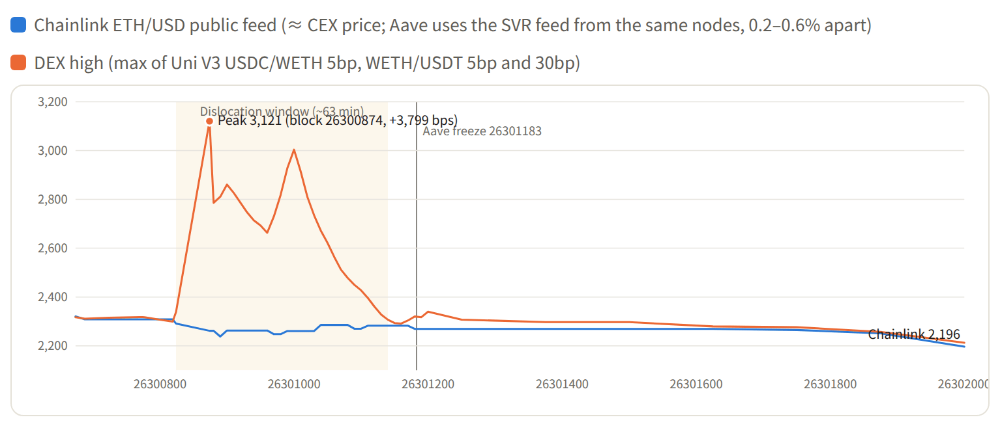

** Aave used Chainlink, not DEX prices

| Block | Aave oracle (WETH) | Chainlink public feed | CoinGecko (CEX aggregate) | DEX high |
|---+---+---+---+---|
| 26300874 | 2,260.15 | 2,261.50 | 2,259.80 | 3,120.53 |
| 26300900 | 2,249.32 | 2,262.72 | 2,254.55 | 2,860.52 |
| 26300950 | 2,255.51 | 2,262.72 | 2,258.60 | 2,692.64 |
| 26301000 | 2,255.51 | 2,260.40 | 2,260.68 | 3,003.43 |
| 26301060 | 2,282.77 | 2,285.27 | 2,278.30 | 2,563.57 |
| 26301140 | 2,281.38 | 2,281.93 | 2,289.76 | 2,306.66 |

Across 49 sample points, Aave's oracle never differed from CoinGecko's CEX aggregate by more than 0.51%, while DEXs ran up to 38.1% higher. The hacker's own Aave borrow confirms it: 60M USDT of collateral borrowed 19,762.41 WETH, using 99.2% of the limit at Aave's oracle price. At the DEX price of about 2,650 the same borrow would have been 116.5% of the limit and impossible.

** No Chainlink node reported the DEX price

Every Chainlink update writes all 31 node reports on-chain. Inside the spread window, the two ETH/USD feeds updated 25 times, for 775 node reports. The highest single report was $2,292.87, while DEXs peaked at $2,861 in the same blocks, and the largest disagreement between nodes was 0.51%.

#+CAPTION: All 38 updates of the two ETH/USD feeds from 04:02 to 07:23. Each point is the highest of that update's 31 node reports; DEX is the pool price at the close of the same block.
#+ATTR_HTML: :alt Line chart: the DEX high rises far above the highest Chainlink node report during the spread window :width 767 :height 299 :loading lazy :decoding async
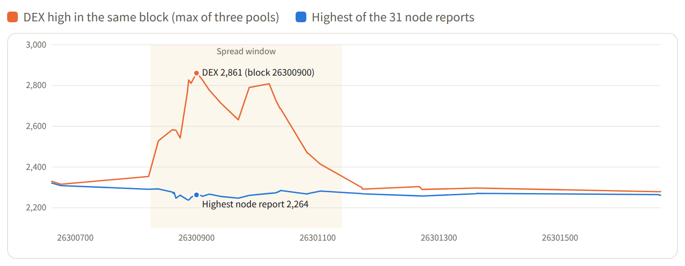

Chainlink didn't sit above or below the CEX price; it tracked it. All 38 reports fell inside Coinbase's high-low range for that minute. Feeds update when the price moves 0.5% or after one hour at most, and node data reaches the chain in about 20 seconds (median). So Aave's price can lag the market by about 0.5%, which is negligible next to a 17–38% spread. The USDT/USD feed never updated during the window at all: the DEX discount never moved the market-wide price.

** The real risk was governance

At 05:47 one transaction froze 11 Aave assets and set the LTV of 5 collateral assets to 0, for about 14.7 hours (until 20:26). Liquidation thresholds didn't change, so existing positions weren't liquidated, but nobody could borrow:

| Asset | LTV before | LTV after | Liquidation threshold (unchanged) |
|---+---+---+---|
| USDT | 75% | 0% | 78% |
| USDC | 75% | 0% | 78% |
| WETH | 81% | 0% | 84% |
| WBTC | 81% | 0% | 85% |
| AAVE | 69% | 0% | 76% |

* What the hacker lost

| Hacker wallet | USDT | ETH received | Avg price | Paid above Chainlink |
|---+---+---+---+---|
| RFQ wallet (9 RFQ fills) | 325.0M | 122,316 | 2,657 | $45.9M |
| DEX wallets (5 DEX trades) | 110.0M | 38,129 | 2,885 | $24.1M |
| Total | 435.0M | 160,445 | 2,711 | ≈ $70.0M |

The report lists the DEX row as 150M USDT for 52,517 ETH, about $77.6M in total. The hacker's on-chain transfers show only 5 DEX buys totaling 110M USDT; the rest of that USDT went into Aave or to frozen addresses. This post uses the on-chain numbers.

The gap went to RFQ solvers, builders (about 1,751 ETH in bribes), arbitrageurs who sold ETH back into the DEXs, and LP fees. Prices were pushed up, then arbitraged back down, so LP inventory ended roughly flat.

* Where the funds are (as of November 2)

- *Cold wallets:* about 430,737 ETH in 4 addresses that have never sent a transaction (about $983M).
- *Frozen by Tether:* about 1.38B USDT across 3 blacklisted addresses.
- *On Aave:* 60M USDT of collateral, 19,766.28 WETH of debt, health factor 1.0364.

| Address | ETH | Source |
|---+---+---|
| Cold wallet A [[https://etherscan.io/address/0x8532fa14acaf483729c449b8458aeddb900543d4][0x8532fa…0543d4]] | 197,460 | From the main wallet (from block 26300842) |
| Cold wallet B [[https://etherscan.io/address/0xc887af690e0301cd4edbbce8f8d31b4ec65b286a][0xc887af…5b286a]] | 137,602 | Proceeds of the RFQ wallet's USDT sales + 0x7f9dc988 |
| Cold wallet C [[https://etherscan.io/address/0x897c80d1a9729e94460e2bd93178bd5215158df3][0x897c80…158df3]] | 78,415 | End of the hacker's chain |
| Cold wallet D [[https://etherscan.io/address/0x03b0ee5d82990cff1bda48651ac3e436d1a020ea][0x03b0ee…a020ea]] | 17,260 | From the main wallet (block 26303416) |

| Frozen address | USDT |
|---+---|
| Main wallet [[https://etherscan.io/address/0x5227f603c1ee34ce3c06efe6477003bdfccb2f8c][0x5227f6…cb2f8c]] | 1,175,464,713 |
| [[https://etherscan.io/address/0xaa246bf639586a6ba46762d378ce50ca4fc654a0][0xaa246b…c654a0]] (RFQ wallet leftover) | 174,999,872 |
| [[https://etherscan.io/address/0xb171ca86f82070282138352ff7111b494060c8c3][0xb171ca…60c8c3]] (0x7aa4 leftover) | 30,000,000 |
